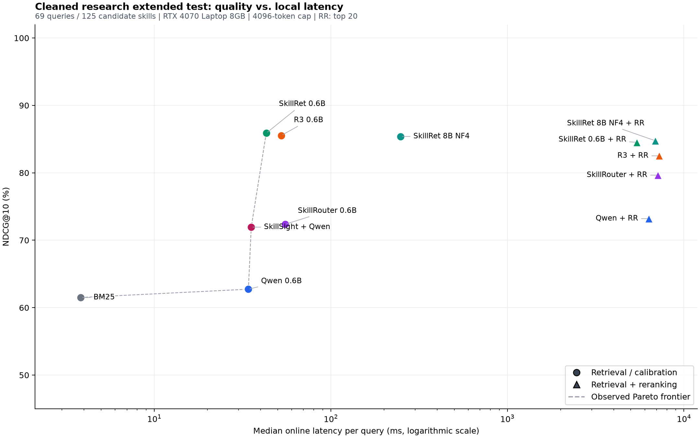

# Research 子集本地评测报告

完成方法配置：12 / 12。全部数字来自本机运行产生的逐请求预测，不引用论文成绩充当本地结果。

图中越靠左上，表示本轮测试中质量越高、耗时越低；虚线只表示本轮观测的非支配配置。

## 评测范围与解释

- 纯研究：22 条 test 请求、64 个候选技能；扩展集：69 条 test 请求、125 个候选技能、125 个 gold 标签。纯研究请求包含在扩展集中，不是 91 条独立请求。
- 保留每个视图的原候选池与 gold 集合；不执行请求任务、不调用外部模型 API、不使用 train 调参。
- 所有嵌入模型使用 name | description | skill_md，4096 token 上限、左侧 padding、末 token 池化与 L2 归一化。重排各自检索器的 top20，使用 yes/no 最末 token 的 logit 差排序，尾部保持原序。
- 0.6B 使用 BF16；8B 使用 bitsandbytes NF4 双重量化、BF16 计算。8B 结果不代表未量化论文结果。模型逐个加载，本轮是统一硬件预算下的适配评测，不是论文原始配置的逐项复现。
- SkillRouter 保留作者发布的 coding task 指令，但文档输入统一为上述格式；R3 保留作者指令和 tokenizer chat template。Qwen 与 SkillRet 使用 SKILLRET 官方评测的 skill search 指令。
- SkillSight 直接调用所下载官方代码，复用本轮 Qwen 嵌入，candidate_k=300（受本地候选数量上限限制），beta=1。其当前官方 retriever 调用 lam=None 的融合分支，与 fusion.py 注释所述论文 Eq.15 的 lam=1 分支不同；本报告明确评测代码版本行为。
- Recall 为逐请求 gold 覆盖率的宏平均；Completeness 是 top-k 包含该请求全部 gold 的请求比例。NDCG 使用二元 qrels，MRR 截止 10。
- 在线耗时 = 单条请求编码 + 搜索排序 + 重排；不含权重加载与离线技能索引。单次运行、先 warmup，无并发吞吐或服务 SLA 含义。SkillSight 的查询编码耗时复用 Qwen 实测值。

硬件：NVIDIA GeForce RTX 4070 Laptop GPU；PyTorch 2.7.1+cu128；随机种子 42。

## 扩展测试集

| 方法 | Hit@1 | Recall@5 | Recall@10 | Completeness@10 | NDCG@10 | MRR@10 | 在线中位数 ms | P95 ms |
|---|---:|---:|---:|---:|---:|---:|---:|---:|
| SkillRet 0.6B | 82.61% | 87.92% | 95.17% | 91.30% | 85.88% | 87.13% | 43.1 | 51.4 |
| R3 0.6B | 82.61% | 87.68% | 93.24% | 89.86% | 85.53% | 87.21% | 52.3 | 76.1 |
| SkillRet 8B (NF4) | 84.06% | 87.92% | 92.27% | 85.51% | 85.39% | 89.66% | 248.7 | 274.7 |
| SkillRet 8B (NF4) + 0.6B reranker | 81.16% | 85.02% | 94.20% | 88.41% | 84.77% | 86.91% | 6871.3 | 7980.6 |
| SkillRet 0.6B + reranker | 81.16% | 88.89% | 93.96% | 89.86% | 84.53% | 86.92% | 5419.5 | 6450.7 |
| R3 0.6B + reranker | 81.16% | 82.61% | 89.61% | 82.61% | 82.52% | 85.77% | 7241.8 | 10829.9 |
| SkillRouter 0.6B + reranker | 88.41% | 75.85% | 79.95% | 62.32% | 79.66% | 90.59% | 7130.4 | 11698.6 |
| Qwen3 0.6B + reranker | 79.71% | 74.15% | 74.88% | 55.07% | 73.20% | 85.80% | 6326.3 | 6991.3 |
| SkillRouter 0.6B | 78.26% | 68.12% | 78.50% | 60.87% | 72.37% | 83.99% | 55.1 | 62.2 |
| SkillSight + Qwen3 0.6B | 78.26% | 71.98% | 76.81% | 62.32% | 71.94% | 82.78% | 35.4 | 37.7 |
| Qwen3 0.6B | 68.12% | 60.63% | 70.29% | 46.38% | 62.74% | 76.73% | 34.1 | 36.5 |
| BM25 | 71.01% | 58.70% | 66.43% | 47.83% | 61.51% | 75.22% | 3.8 | 5.2 |

本次 NDCG@10 最高：SkillRet 0.6B，0.8588；按请求自助采样 2000 次的 95% 区间 [0.8009, 0.9129]。该区间不校正多方法选择，也不能据此断言方法差异显著。

## 纯研究测试集

| 方法 | Hit@1 | Recall@5 | Recall@10 | Completeness@10 | NDCG@10 | MRR@10 | 在线中位数 ms | P95 ms |
|---|---:|---:|---:|---:|---:|---:|---:|---:|
| SkillRet 8B (NF4) | 72.73% | 90.91% | 95.45% | 95.45% | 83.52% | 79.70% | 202.2 | 253.8 |
| R3 0.6B | 68.18% | 95.45% | 100.00% | 100.00% | 83.38% | 78.07% | 44.8 | 78.9 |
| SkillRet 0.6B | 68.18% | 86.36% | 95.45% | 95.45% | 80.34% | 75.66% | 43.3 | 45.8 |
| SkillRouter 0.6B + reranker | 72.73% | 77.27% | 86.36% | 86.36% | 78.65% | 76.33% | 7229.7 | 9398.2 |
| SkillRet 8B (NF4) + 0.6B reranker | 50.00% | 77.27% | 100.00% | 100.00% | 73.26% | 64.98% | 7196.9 | 8163.9 |
| Qwen3 0.6B + reranker | 54.55% | 81.82% | 86.36% | 86.36% | 71.45% | 66.56% | 6021.2 | 7140.4 |
| R3 0.6B + reranker | 59.09% | 77.27% | 86.36% | 86.36% | 70.48% | 65.61% | 5945.2 | 7303.1 |
| SkillRet 0.6B + reranker | 50.00% | 77.27% | 95.45% | 95.45% | 70.29% | 62.62% | 5548.5 | 6625.8 |
| SkillRouter 0.6B | 50.00% | 77.27% | 86.36% | 86.36% | 67.74% | 61.86% | 51.0 | 67.6 |
| SkillSight + Qwen3 0.6B | 54.55% | 63.64% | 72.73% | 72.73% | 62.14% | 58.90% | 38.1 | 41.0 |
| Qwen3 0.6B | 36.36% | 68.18% | 77.27% | 77.27% | 56.65% | 50.09% | 37.4 | 40.1 |
| BM25 | 45.45% | 59.09% | 68.18% | 68.18% | 54.84% | 50.85% | 2.2 | 2.7 |

本次 NDCG@10 最高：SkillRet 8B (NF4)，0.8352；按请求自助采样 2000 次的 95% 区间 [0.7067, 0.9480]。该区间不校正多方法选择，也不能据此断言方法差异显著。

## 本轮选型判断

以扩展集 NDCG@10 排序，最高配置为 SkillRet 0.6B（85.88%，完整覆盖率 91.30%，单请求在线中位耗时 43.1ms）。

若本机单次测量的中位耗时预算约 100ms，可优先参考 SkillRet 0.6B（NDCG@10 85.88%，完整覆盖率 91.30%，中位耗时 43.1ms）。此门槛仅用于解读本轮结果，不是生产延迟承诺。

这两项是样本内观察，不等于统计显著或生产选型结论；在进入实现前，应再用全量测试候选池验证路由质量、长文档策略及拒识行为。

## 混合任务与重排收益

仅取扩展集中 47 条多技能请求，候选池仍为 125；该切片不额外调用模型。

| 方法 | Recall@10 | Completeness@10 | NDCG@10 |
|---|---:|---:|---:|
| SkillRet 0.6B | 95.04% | 89.36% | 88.75% |
| SkillRet 0.6B + reranker | 93.26% | 87.23% | 90.50% |
| R3 0.6B | 90.07% | 85.11% | 86.54% |
| SkillRet 8B (NF4) + 0.6B reranker | 91.49% | 82.98% | 89.86% |
| R3 0.6B + reranker | 91.13% | 80.85% | 88.15% |
| SkillRet 8B (NF4) | 90.78% | 80.85% | 86.27% |
| SkillSight + Qwen3 0.6B | 78.72% | 57.45% | 76.38% |
| SkillRouter 0.6B + reranker | 76.95% | 51.06% | 80.10% |
| SkillRouter 0.6B | 74.82% | 48.94% | 74.83% |
| Qwen3 0.6B + reranker | 71.63% | 42.55% | 75.61% |
| BM25 | 65.60% | 38.30% | 64.71% |
| Qwen3 0.6B | 67.02% | 31.91% | 67.25% |

| 配对方法（扩展集） | 重排后 NDCG@10 变化 | 完整覆盖率变化 | 在线中位耗时倍数 |
|---|---:|---:|---:|
| Qwen3 0.6B | +10.46 个百分点 | +8.70 个百分点 | 185.5x |
| SkillRet 0.6B | -1.35 个百分点 | -1.45 个百分点 | 125.9x |
| SkillRouter 0.6B | +7.29 个百分点 | +1.45 个百分点 | 129.4x |
| R3 0.6B | -3.01 个百分点 | -7.25 个百分点 | 138.4x |
| SkillRet 8B (NF4) | -0.62 个百分点 | +2.90 个百分点 | 27.6x |

## 输入截断与离线建库

| 方法 | 扩展文档截断 | 扩展查询截断 | 纯研究文档截断 | 纯研究查询截断 | 扩展建库秒 |
|---|---:|---:|---:|---:|---:|
| Qwen3 0.6B | 14/125 | 0/69 | 9/64 | 0/22 | 29.94 |
| SkillRet 0.6B | 14/125 | 0/69 | 9/64 | 0/22 | 30.78 |
| SkillRouter 0.6B | 14/125 | 0/69 | 9/64 | 0/22 | 33.32 |
| R3 0.6B | 14/125 | 0/69 | 9/64 | 0/22 | 45.41 |
| SkillRet 8B (NF4) | 14/125 | 0/69 | 9/64 | 0/22 | 147.37 |

重排输入截断统计（两个视图合计，分母包含 1 对未截断 warmup；每次最多输入 4096 token，保留 assistant 后缀）：

| 方法 | 被截断的请求—技能对 |
|---|---:|
| Qwen3 0.6B + reranker | 422/1821 |
| SkillRet 0.6B + reranker | 275/1821 |
| SkillRouter 0.6B + reranker | 478/1821 |
| R3 0.6B + reranker | 284/1821 |
| SkillRet 8B (NF4) + 0.6B reranker | 354/1821 |

## 典型错误（扩展集）

### q-04418

用户请求：We're evaluating whether to adopt Apache Kafka Streams vs. Apache Flink for our real-time fraud detection pipeline at `~/repos/txn-guardian`. The pipeline needs to process ~500K credit card transactions per second, apply sliding window aggregations (30s, 5min, 1hr), join against a profile store, and emit alerts with sub-200ms p99 latency. I need you to do a deep-dive comparison of both frameworks specifically for this use case — look into their latest documentation for exactly-once semantics guarantees, state store backends and their performance characteristics under high-cardinality keys, windowing semantics differences (especially how each handles late-arriving events and watermarks), backpressure mechanisms, and fault recovery time after broker failures. Also investigate real-world production benchmarks or case studies from fintech/payments companies who've operated either at similar scale. For each framework, identify the gotchas and anti-patterns documented in their official guides or notable community post-mortems that would be relevant to a fraud detection workload with strict latency SLAs. Synthesize everything into a structured recommendation document at `~/repos/txn-guardian/docs/streaming-engine-evaluation.md` with sections for architecture fit, operational complexity, ecosystem maturity, and a final recommendation with clear justification.

Gold：research（第 24 名）

Top3：websearch-deep；web-research-documenter；research

SkillRet 0.6B NDCG@10=0.0000；SkillRet 0.6B + reranker=0.0000。

### q-03656

用户请求：We're rebuilding our e-commerce platform's search and recommendation engine at `~/repos/shop-discover` (Python 3.11, FastAPI, Elasticsearch 8, Redis) and before writing any code I need you to do an exhaustive landscape analysis. Specifically, I want you to research the current state-of-the-art in hybrid search architectures that combine vector/semantic search with traditional keyword search for product discovery — covering the latest approaches from major players (Algolia, Typesense, Vespa, Meilisearch, etc.), recent academic papers on learned sparse retrieval and late-interaction models like ColBERT for e-commerce, emerging trends in LLM-powered query understanding and re-ranking, and UX research on how search result presentation (facets, visual merchandising, infinite scroll vs pagination, zero-result recovery) impacts conversion rates in online retail. I also need competitive intelligence on how Shopify, Amazon, and Etsy have evolved their search stacks in 2024-2025 based on any public engineering blog posts or conference talks. Cross-reference everything and give me a structured report with citations that we can use as the architectural decision record foundation before we start implementation.

Gold：ultimate-research（第 8 名）

Top3：perplexity-research；deep-research；Matrix Deep Research

SkillRet 0.6B NDCG@10=0.3010；SkillRet 0.6B + reranker=0.3155。

### q-01893

用户请求：How does the new Bun 1.2 runtime compare to Deno 2 and Node.js 22 for running a high-concurrency WebSocket server — specifically around memory usage, cold start time, and native TypeScript support? I want to pick one for a real-time collaborative whiteboard app and need current benchmarks and any known gotchas before I commit to a runtime.

Gold：researching-web（第 6 名）

Top3：internet-deep-orchestrator；typography；cxo-briefing-kit

SkillRet 0.6B NDCG@10=1.0000；SkillRet 0.6B + reranker=0.3562。

### q-00115

用户请求：We're building a new internal developer portal and need to pick the right static site generator for it. The candidates are Docusaurus, MkDocs (Material theme), Astro Starlight, and GitBook. Our requirements span several dimensions with different importance levels: Git-based workflow integration (critical), support for versioned API docs with OpenAPI rendering (high), plugin/extension ecosystem (medium), build performance for 2,000+ pages (high), MDX or custom component support (medium), SSO/RBAC for private docs (critical), self-hosting without vendor lock-in (high), learning curve for 40+ backend engineers who mostly know Markdown (medium), and active maintenance/community health (low-medium). Can you build me a weighted scoring matrix that rates each tool on a 1-5 scale across these criteria, explains the rationale behind each score with specific evidence (e.g., GitHub stars, release cadence, known limitations from their issue trackers), and gives a final normalized recommendation? Also flag any dealbreakers where a tool scores below 2 on a critical criterion so we can eliminate it early.

Gold：technical-research（第 5 名）

Top3：Searching Scientific Literature；Academic Researcher；nma-methodology

SkillRet 0.6B NDCG@10=1.0000；SkillRet 0.6B + reranker=0.3869。

### q-00766

用户请求：We're architecting the real-time data pipeline for our "FieldPulse" precision agriculture platform and need to choose between three candidate stacks: (1) Apache Kafka + Apache Flink + TimescaleDB, (2) AWS Kinesis + AWS Lambda + Amazon Timestream, and (3) RedPanda + Materialize + ClickHouse. The pipeline ingests ~500K sensor events/sec from IoT soil moisture, temperature, and drone imagery sensors across 12,000 farm plots, needs sub-2-second end-to-end latency for irrigation trigger alerts, must handle 3x seasonal burst traffic during planting/harvest, and we need to retain 5 years of historical data for ML model training. Our team is 4 backend engineers (strong in Python/Go, limited Kafka experience), we're currently on AWS but open to multi-cloud, our budget ceiling is $18K/month for the pipeline infrastructure, and we have a hard compliance requirement for data residency in the US and EU. Can you build me a weighted scoring matrix comparing these three options across operational complexity, latency guarantees, cost at our scale, team skill fit, managed-vs-self-hosted maintenance burden, ecosystem maturity, schema evolution support, and vendor lock-in risk? Weight the criteria based on our specific constraints, score each option on a 1-5 scale with justifications, calculate weighted totals, and give me a final recommendation with a clear rationale for why the winner edges out the runner-up.

Gold：technical-research（第 5 名）

Top3：webresearcher；internet-deep-orchestrator；effect-size

SkillRet 0.6B NDCG@10=1.0000；SkillRet 0.6B + reranker=0.3869。

## 纯研究重排复核案例

以下为本轮 SkillRet 重排相对检索器退步最大的两个纯研究案例。只描述实际排名变化，不据此认定 gold 错误或确定退步原因。

### q-00115

We're building a new internal developer portal and need to pick the right static site generator for it. The candidates are Docusaurus, MkDocs (Material theme), Astro Starlight, and GitBook. Our requirements span several dimensions with different importance levels: Git-based workflow integration (critical), support for versioned API docs with OpenAPI rendering (high), plugin/extension ecosystem (medium), build performance for 2,000+ pages (high), MDX or custom component support (medium), SSO/RBAC for private docs (critical), self-hosting without vendor lock-in (high), learning curve for 40+ backend engineers who mostly know Markdown (medium), and active maintenance/community health (low-medium). Can you build me a weighted scoring matrix that rates each tool on a 1-5 scale across these criteria, explains the rationale behind each score with specific evidence (e.g., GitHub stars, release cadence, known limitations from their issue trackers), and gives a final normalized recommendation? Also flag any dealbreakers where a tool scores below 2 on a critical criterion so we can eliminate it early.

Gold：technical-research；检索第 1 名 → 重排第 10 名。

重排 Top3：Searching Scientific Literature；Academic Researcher；paper-search-usage

### q-00766

We're architecting the real-time data pipeline for our "FieldPulse" precision agriculture platform and need to choose between three candidate stacks: (1) Apache Kafka + Apache Flink + TimescaleDB, (2) AWS Kinesis + AWS Lambda + Amazon Timestream, and (3) RedPanda + Materialize + ClickHouse. The pipeline ingests ~500K sensor events/sec from IoT soil moisture, temperature, and drone imagery sensors across 12,000 farm plots, needs sub-2-second end-to-end latency for irrigation trigger alerts, must handle 3x seasonal burst traffic during planting/harvest, and we need to retain 5 years of historical data for ML model training. Our team is 4 backend engineers (strong in Python/Go, limited Kafka experience), we're currently on AWS but open to multi-cloud, our budget ceiling is $18K/month for the pipeline infrastructure, and we have a hard compliance requirement for data residency in the US and EU. Can you build me a weighted scoring matrix comparing these three options across operational complexity, latency guarantees, cost at our scale, team skill fit, managed-vs-self-hosted maintenance burden, ecosystem maturity, schema evolution support, and vendor lock-in risk? Weight the criteria based on our specific constraints, score each option on a 1-5 scale with justifications, calculate weighted totals, and give me a final recommendation with a clear rationale for why the winner edges out the runner-up.

Gold：technical-research；检索第 1 名 → 重排第 8 名。

重排 Top3：systematic-review；webresearcher；internet-deep-orchestrator

## 限制与结果文件

- 这是经模型辅助清洗的合成请求小样本；保留标签不构成独立专家金标准。未标注替代技能可能同样可用。
- 候选池只有 64/125，不能外推到 SKILLRET 全集 6006 个测试技能，更不能与论文全量成绩直接比较。
- SkillRet 使用原始 train 训练；本轮只评原始 test。R3 等模型训练来源可能包含 SKILLRET，未完成跨项目训练样本重叠审计，不将其称为严格零样本评测。
- 4096 token 会截断部分长技能；截断数见上表。没有验证路由后技能执行成功率、拒识能力、训练/测试语义近重复或跨语言泛化。
- 逐请求排名与指标：`runs/research-test-20261029/*_embedding.json`、`*_reranked.json`；统一汇总：`summary.json`；协议、输入哈希和权重 revision：`protocol.json`。
- 权重文件完整性：`models/MANIFEST.json`；代码来源：`config/deployment_sources.json`；环境：`config/requirements-local.lock.txt`。

## 上游来源

- [SKILLRET](https://github.com/ThakiCloud/SKILLRET)
- [SkillRouter](https://github.com/zhengyanzhao1997/SkillRouter)
- [R3-Skill](https://github.com/Tencent/R3-Skill)
- [Qwen3-Embedding](https://github.com/QwenLM/Qwen3-Embedding)
- [SkillSight](https://github.com/xiaojinying/SkillSight)

本轮嵌入批量为 2（8B 为 1），重排批量为 8，并在每条请求内按文本 token 长度分组后恢复候选对应关系。部分配置评测期间有并行权重下载，桌面进程也可能带来系统负载，耗时仅作本机单次测量。

R3 重排适配修正了 Transformers 5.5.4 的模板返回类型，并从实际渲染结果提取长文本截断后保留的 assistant 后缀；在修复前没有接受任何完整 R3 重排结果。此前九个已完成配置的评分函数未改动、预测予以保留。`protocol.json` 的 `artifact_evaluator_sha256` 为每个配置记录实测代码版本，`measurement_source_snapshots` 保留相应完整源码快照。

BM25 使用 rank-bm25 的 BM25Okapi 默认参数（k1=1.5、b=0.75），以小写 Unicode \w+ 分词、不去停用词、不截断全文；该实现不同于 SKILLRET 当前官方脚本的 bm25s 基线。SkillSight 的词汇统计采用官方默认每文档前 200 个不同 token。

## 本地权重清单

下列为官方原始快照；8B 的 NF4 量化在加载时完成。所有文件下载时均核对上游 LFS SHA256 或 Git blob SHA1，完整 SHA256 保存在模型清单中。

| Hugging Face 模型 | Revision（前12位） | 本地快照 GiB |
|---|---|---:|
| Qwen/Qwen3-Embedding-0.6B | 97b0c614be4d | 1.12 |
| Qwen/Qwen3-Reranker-0.6B | e61197ed4502 | 1.12 |
| ThakiCloud/SKILLRET-Embedding-0.6B | 67f1594c46c4 | 1.12 |
| ThakiCloud/SKILLRET-Reranker-0.6B | ce09c883af78 | 1.12 |
| pipizhao/SkillRouter-Embedding-0.6B | c03c9bcee9fc | 1.12 |
| pipizhao/SkillRouter-Reranker-0.6B | 78986e1142d1 | 1.12 |
| tencent/R3-embedding-0.6b | 9df7e112330d | 2.23 |
| tencent/R3-rerank-0.6b | 6d0c3e486b86 | 2.23 |
| ThakiCloud/SKILLRET-Embedding-8B | 2d4e641bd6c5 | 14.11 |

已校验快照共 9 份，占 25.31 GiB（不含代码、Python 环境和下载缓存）。

## 本机注意力后端验证

PyTorch 2.7.1 的 Windows wheel 不含 Flash Attention。本轮统一采用 memory-efficient SDPA，并使用 Transformers 现有的显式 KV 重复分支处理 GQA，禁用默认 math/cuDNN 后备内核。固定两对 4096-token 文本的检查中，默认路径 4.791s，优化路径 0.652s；yes/no logit 差的最大绝对变化 0.0625，该固定样例的排序一致。此检查不证明全语料数值完全相同，正式表格全部在统一优化后端下重新计算。

[PyTorch SDPA 文档](https://docs.pytorch.org/docs/2.7/generated/torch.nn.functional.scaled_dot_product_attention.html)；验证明细：`runs/efficient-attention-validation.json`。
